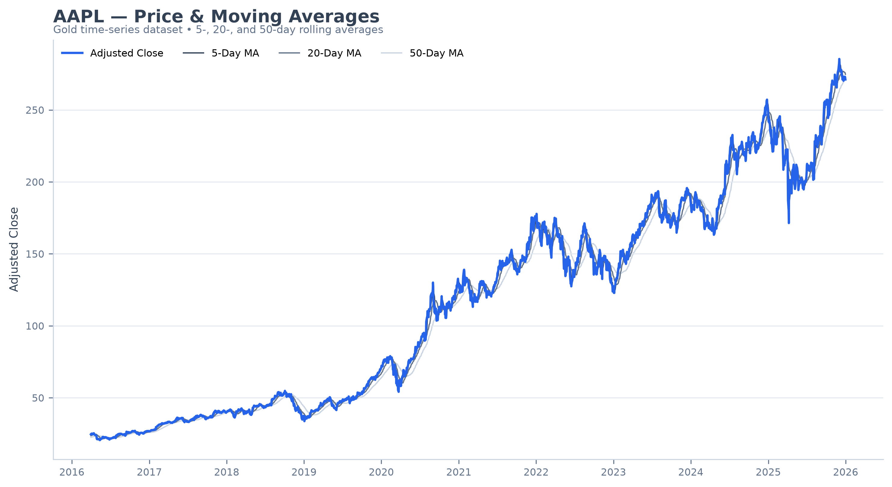

# Financial Market Data Lakehouse

A local **Delta Lake medallion pipeline** built with PySpark. It ingests ten years of daily market data for 20
sector-diverse US equities from Yahoo Finance, refines it through Bronze → Silver → Gold, and publishes two
ML-ready datasets: a **time-series forecasting panel** and a **classification dataset** with leakage-safe splits.



## Architecture

```
 yfinance ──► BRONZE  market_prices        append-only raw batches, ingestion lineage
                 │
                 ▼    dedupe (ticker, date) → latest ingestion
              SILVER  market_prices        MERGE upsert, typed, sector-enriched
                      quarantine           records failing data-quality rules
                      ticker_reference     sector dimension
                 │
                 ▼    window features on adjusted prices (full windows only)
              GOLD    daily_features       27 features + forward-return targets
                      time_series          forecasting panel
                      classification       labels + purged train/validation/test
                      baseline_metrics     sanity-check models
```

| Layer  | Write pattern             | Guarantee demonstrated                                         |
|--------|---------------------------|----------------------------------------------------------------|
| Bronze | `append`                  | Immutable raw history; any batch can be replayed               |
| Silver | `MERGE` on `(ticker, date)` | Idempotent upserts; replaying older batches never overwrites newer data |
| Gold   | `overwrite`               | Full recompute from Silver; prior versions kept via time travel |

All tables are Delta tables under `data/lakehouse/`.

### Silver data-quality rules

Required fields present · prices > 0 · volume ≥ 0 · high ≥ low · high ≥ max(open, close) · low ≤ min(open, close).
Failing records are written to `silver/quarantine` with a `failed_rules` array instead of being dropped silently.

## Datasets

### Gold features (`gold/daily_features`)

Computed per ticker on **dividend-adjusted** prices. Rolling statistics are null until their window is full, and
every feature uses only information available at that day's close. Features are scale-free so they are comparable
across tickers:

| Group    | Features |
|----------|----------|
| Returns  | `log_return_1d`, `return_lag_1..5` |
| Momentum | `momentum_5`, `momentum_20`, `momentum_60` |
| Trend    | `price_vs_ma_{5,20,50}`, `ma_5_vs_ma_20`, `ma_20_vs_ma_50` |
| Risk     | `volatility_{5,20,50}`, `volatility_ratio_5_20`, `intraday_range`, `overnight_gap`, `rsi_14` |
| Volume   | `relative_volume_20` |
| Market   | `market_log_return_1d`, `excess_log_return_1d`, `sector_log_return_1d` (equal-weighted) |
| Calendar | `day_of_week`, `month_of_year` |

Targets: `fwd_log_return_{1,5,20}d`.

### Time series (`gold/time_series`)

One contiguous row per ticker per trading day once features are complete (~49k rows, 2016-03 → 2025-12). Includes
`adj_close` and `volume` for classical univariate models. The last rows of each series have null targets; they are
forecast origins.

### Classification (`gold/classification`)

| Label | Definition |
|-------|------------|
| `direction_{1,5,20}d` | 1 if the forward log return is positive |
| `trend_5d` | 0 = down, 1 = flat, 2 = up; a move counts only if it exceeds `0.5 × volatility_20 × √5` |

Chronological splits: **train** ≤ 2022-12-31, **validation** 2023, **test** 2024–2025. Rows whose 20-day label
window crosses a split boundary are **purged**, so no training label is realised with validation-period prices.

### Baseline results

Logistic regression and random forest, trained on train, compared with always predicting the majority class:

| Label | Split | Majority baseline | Logistic regression | Random forest |
|-------|-------|------------------:|--------------------:|--------------:|
| `direction_5d` | validation | 0.570 | 0.570 | 0.570 |
| `direction_5d` | test       | 0.577 | 0.578 | 0.577 |
| `trend_5d`     | validation | 0.392 | 0.410 | 0.402 |
| `trend_5d`     | test       | 0.385 | 0.417 | 0.416 |

Five-day direction is essentially unpredictable from these features. The models just learn the upward drift of
equities. The volatility-scaled trend label gives a small but consistent lift on both held-out periods.

## Usage

Requires Python 3.11+ and Java 17. The Delta Lake JARs are downloaded automatically on first run.

```bash
pip install -e ".[dev,notebook]"

python -m financial_lakehouse --evaluate              # ingest, build all layers, train baselines
python -m financial_lakehouse --skip-ingest           # rebuild Silver/Gold from Bronze history (offline)
python -m financial_lakehouse --tickers AAPL JPM XOM  # subset of the configured universe

pytest                                                # offline unit tests on synthetic data
```

Configuration (ticker universe, date range, horizons, label threshold, split dates) lives in
`src/financial_lakehouse/config.py`. `notebooks/lakehouse-pipeline.ipynb` runs the pipeline and inspects each
layer. `notebooks/notebook.ipynb` is the original exploratory notebook.

## Project layout

```
src/financial_lakehouse/
  config.py       paths, ticker universe, horizons, split dates
  spark.py        Spark session with Delta Lake
  storage.py      Delta read / write / merge / history helpers
  ingestion.py    yfinance download + ingestion metadata
  bronze.py       raw append-only table
  silver.py       dedupe, quality rules, quarantine, MERGE
  gold.py         feature engineering + forward targets
  datasets.py     time-series and classification datasets, splits, purging
  validation.py   dataset integrity checks
  modeling.py     baseline classifiers
  pipeline.py     orchestration
  cli.py          command-line entry point
tests/            pytest suite (synthetic data, no network)
```
